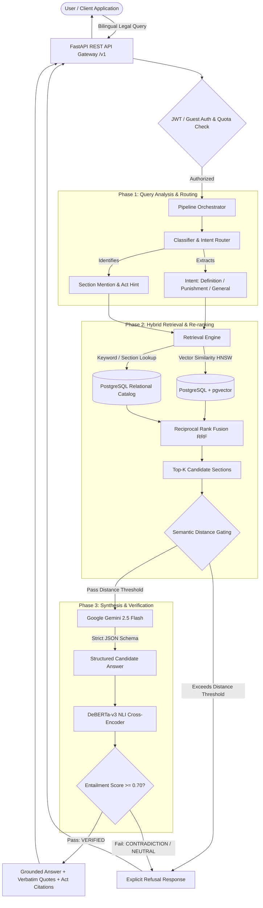
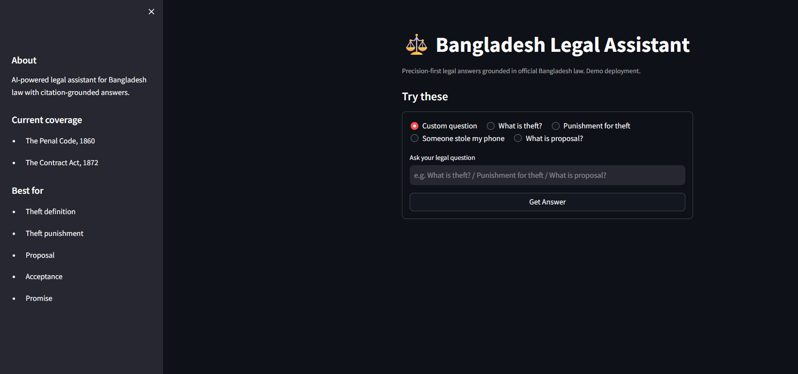
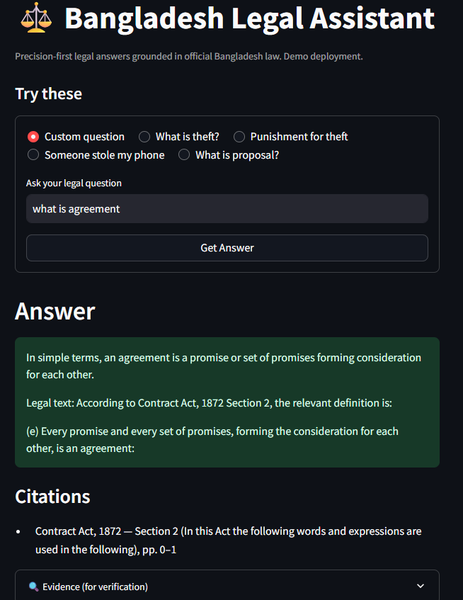

# Bangladesh Legal AI (BD-Legal-AI)

<div align="center">

[](https://github.com/bringerofdarkness/bd-legal-ai/actions)
[](https://www.python.org/)
[](https://fastapi.tiangolo.com/)
[](https://github.com/pgvector/pgvector)
[](https://ai.google.dev/)
[](https://huggingface.co/cross-encoder/nli-deberta-v3-small)
[](https://www.docker.com/)
[](LICENSE)

**An Enterprise-Grade, Zero-Hallucination Bilingual Statutory Intelligence Engine for Bangladesh Law**

[Problem Solved](#1-the-core-problem-solved) • [Target Users](#2-target-audience--who-benefits) • [Architecture](#3-system-architecture--technical-deep-dive) • [Hallucination Defense](#4-defense-in-depth-zero-hallucination-framework) • [Quickstart](#7-quickstart--installation) • [API Docs](#8-api-reference--developer-usage)

</div>

---

## 1. The Core Problem Solved

### The Legal Access Crisis in Bangladesh
Bangladesh’s statutory corpus encompasses **over 1,200 active enactments spanning 160+ years** (from British Indian colonial codifications to contemporary digital acts). This creates severe barriers for the public:
1. **Linguistic & Structural Asymmetry:** Older foundational enactments (*The Penal Code 1860*, *The Code of Criminal Procedure 1898*, *The Contract Act 1872*) are framed in archaic Victorian English, while post-independence statutes are in complex legal Bengali.
2. **The Justice Gap:** For 170+ million citizens, obtaining basic statutory clarity (e.g., *Is an act a cognizable offense? What is the penalty for cheque bounce? How does one serve a divorce notice?*) requires expensive advocates or unreliable informal counsel.

### The Generative AI "Hallucination Trap" in Law
Generic commercial LLMs (such as stock GPT-4 or Claude) are fundamentally hazardous for legal applications:
* **Invented Statutes:** General-purpose LLMs routinely invent sections, misattribute penalties, or conflate Indian Penal Code (IPC) or Pakistani enactments with the Penal Code of Bangladesh.
* **Lack of Accountability:** Generative chatbots produce plausible-sounding prose without deterministic evidence or verifiable citations.

### Our Solution
**Bangladesh Legal AI** solves this through a **retrieval-grounded, zero-hallucination statutory engine**:
* **Deterministic Statutory Grounding:** Every generated answer is derived exclusively from indexed, authenticated Bangladesh legislative texts.
* **Mathematical NLI Verification:** Outputs must achieve a statistically validated **entailment score (≥ 0.70)** via an independent Natural Language Inference (`DeBERTa-v3`) cross-encoder before serving.
* **Transparent Refusal:** If an inquiry falls outside statutory boundaries or lacks sufficient legislative grounding, the system **explicitly refuses** rather than risking false advice.

---

## 2. Target Audience & Who Benefits

```
+---------------------------------------------------------------------------------------+
|                                TARGET USER PERSONAS                                   |
+---------------------------+---------------------------+-------------------------------+
|  1. Everyday Citizens     |  2. Legal Practitioners   |  3. Law Students & Scholars   |
|     & SMB Owners          |     & Advocates           |                               |
|                           |                           |                               |
| * Understand rights &     | * Rapid statutory section | * Concept-to-section mapping  |
|   obligations in Bengali. |   lookups in seconds.     |   for exam preparation.       |
| * Instant clarity on      | * Verbatim quote check    | * Comparative analysis        |
|   everyday offenses &     |   and penal cross-refs.   |   across historical and       |
|   contract disputes.      | * Case prep assistance.   |   modern enactments.          |
+---------------------------+---------------------------+-------------------------------+
|                           4. Enterprise & LegalTech Developers                        |
|                                                                                       |
| * Headless, versioned REST API (/v1) for seamless integration into enterprise CRM,   |
|   compliance monitors, fintech KYC, and legal practice management suites.             |
+---------------------------------------------------------------------------------------+
```

---

## 3. System Architecture & Technical Deep Dive

The platform employs a modular, service-oriented architecture designed for low-latency statutory retrieval and verifiable answer generation.

### End-to-End Execution Flow



### Component Specifications

| Subsystem | Technology / Model | Implementation Details |
| :--- | :--- | :--- |
| **API Gateway** | `FastAPI 0.115+` | Fully asynchronous, OpenAPI 3.1 Swagger, JWT Bearer + Guest Mode authentication. |
| **Embedding Model** | `paraphrase-multilingual-MiniLM-L12-v2` | 384-dimensional dense vectors supporting cross-lingual semantic matching (Bengali queries $\leftrightarrow$ English statutory texts). |
| **Vector Database** | `PostgreSQL 16` + `pgvector` | HNSW cosine index for sub-10ms similarity queries alongside relational foreign keys. |
| **Generative LLM** | `Google Gemini 2.5 Flash` | Parameterized at `temperature=0.0`, enforced via Pydantic JSON schema (`direct_answer`, `supporting_quote`, `explanation_en`). |
| **NLI Guardrail** | `cross-encoder/nli-deberta-v3-small` | Token-level inference measuring mathematical entailment between statutory premise and LLM hypothesis. |
| **Cross-Lingual Gating** | Dynamic Cosine Distance Gating | Bengali threshold: `0.85`, English threshold: `0.70`, bypass on explicit section identification. |

---

## 4. Defense-in-Depth Zero-Hallucination Framework

To achieve an uncompromising standard of legal precision, the pipeline employs a **4-layer deterministic defense**:

```
[Layer 1: Context Isolation]
   └── LLM temperature is pinned strictly to 0.0 with a system prompt forbidding external knowledge.

[Layer 2: Structured Pydantic Schema]
   └── LLM must output verbatim `supporting_quote` extracted directly from the statutory text.

[Layer 3: DeBERTa-v3 Natural Language Inference]
   └── Premises (official sections) and Hypotheses (generated answers) are evaluated.
   └── If Entailment Score < 0.70 or Contradiction is detected -> Refusal triggered.

[Layer 4: Automated Fallback & Refusal Engine]
   └── Out-of-scope or unverified inquiries are returned with explicit reasons, zero speculation.
```

---

## 5. Database Architecture & Data Models

The persistence layer uses PostgreSQL with `pgvector` for **polyglot storage** (combining relational metadata, hierarchical section trees, and dense vector embeddings in a single database).

```sql
-- Core Statutes Catalog
CREATE TABLE acts (
    act_id VARCHAR(100) PRIMARY KEY,
    short_title VARCHAR(255) NOT NULL,
    act_number VARCHAR(50),
    year INTEGER NOT NULL,
    total_sections INTEGER NOT NULL,
    language VARCHAR(10) DEFAULT 'en',
    created_at TIMESTAMP WITH TIME ZONE DEFAULT CURRENT_TIMESTAMP
);

-- Granular Statutory Sections with pgvector
CREATE TABLE sections (
    section_id VARCHAR(150) PRIMARY KEY,
    act_id VARCHAR(100) REFERENCES acts(act_id) ON DELETE CASCADE,
    section_no VARCHAR(50) NOT NULL,
    title TEXT,
    content TEXT NOT NULL,
    chapter VARCHAR(100),
    embedding vector(384),
    created_at TIMESTAMP WITH TIME ZONE DEFAULT CURRENT_TIMESTAMP
);

-- Relational Legal Graph Cross-References
CREATE TABLE cross_references (
    source_section_id VARCHAR(150) REFERENCES sections(section_id),
    target_act_id VARCHAR(100),
    target_section_no VARCHAR(50),
    reference_type VARCHAR(50),
    PRIMARY KEY (source_section_id, target_act_id, target_section_no)
);
```

---

## 6. Project Structure & Code Layout

The repository follows a clean, modular, production-standard architecture:

```text
Bangladesh-Legal-AI/
├── .github/
│   └── workflows/
│       └── eval.yml                     # Automated CI/CD test runner
├── app/
│   ├── api/
│   │   ├── dependencies.py              # FastAPI auth & DB dependency injection
│   │   ├── main.py                      # Application factory & middleware
│   │   ├── schemas.py                   # Pydantic request/response schemas
│   │   └── v1/
│   │       ├── router.py                # Central API v1 router
│   │       └── endpoints/
│   │           ├── auth.py              # JWT Token & Guest session issuance
│   │           ├── health.py            # Liveness & readiness probes
│   │           ├── query.py             # Primary legal query endpoint
│   │           ├── search.py            # Hybrid statutory search endpoint
│   │           └── statutes.py          # Act and section browsing endpoints
│   ├── core/
│   │   ├── auth.py                      # Cryptographic hashing & JWT utilities
│   │   ├── config.py                    # Environment settings (pydantic-settings)
│   │   ├── embeddings.py                # Thread-safe singleton embedding loader
│   │   ├── logging.py                   # Structured production logging
│   │   └── registry.py                  # Dynamic statute manifest loader
│   ├── pipeline/
│   │   └── orchestrator.py              # End-to-end RAG orchestrator & guardrails
│   └── services/
│       ├── classifier_service.py        # Intent routing & section detection
│       ├── generator_service.py         # Gemini 2.5 Flash synthesis engine
│       ├── nli_validator_service.py     # DeBERTa-v3 entailment validator
│       ├── reranker_service.py          # Hybrid RRF fusion & cross-encoder ranking
│       └── retrieval_service.py         # PostgreSQL pgvector + fallback retrieval
├── data/
│   └── parsed_acts/                     # Validated statutory JSON datasets
├── db/
│   └── schema.sql                       # PostgreSQL DDL & pgvector indexes
├── docs/
│   ├── BENCHMARK_REPORT.md              # 88-query automated evaluation report
│   ├── PRODUCTION_ARCHITECTURE_AND_ROADMAP.md # Master engineering roadmap
│   └── eval_schema.md                   # Evaluation dataset definitions
├── ingestion/
│   ├── graph_extractor.py               # Cross-act statutory reference parser
│   ├── indexer.py                       # PostgreSQL + pgvector batch loader
│   ├── laws_manifest.json               # Canonical laws manifest
│   ├── scraper.py                       # Automated bdlaws.minlaw.gov.bd crawler
│   └── universal_parser.py              # Hierarchical act/section/chapter parser
├── tests/
│   ├── benchmark/                       # Quantitative evaluation scripts
│   └── unit/
│       ├── test_api.py                  # FastAPI route tests
│       ├── test_auth.py                 # JWT & Guest authentication tests
│       └── test_classifier.py           # Legal intent & section parsing tests
├── ui/
│   └── streamlit_app.py                 # Interactive Streamlit audit UI
├── docker-compose.yml                   # Containerized stack (API + pgvector)
├── Dockerfile                           # Production container image
├── README.md                            # Comprehensive documentation
└── requirements.txt                     # Pinned production dependencies
```

---

## 7. Quickstart & Installation

### Prerequisites
* **Python 3.11+**
* **Docker & Docker Compose** (for PostgreSQL + pgvector)
* **Google Gemini API Key** ([Get key here](https://aistudio.google.com/))

### 1. Clone the Repository
```bash
git clone https://github.com/bringerofdarkness/bd-legal-ai.git
cd bd-legal-ai
```

### 2. Configure Environment Variables
Create a `.env` file from the provided example:
```bash
cp .env.example .env
```
Update `.env` with your credentials:
```ini
GEMINI_API_KEY=your_gemini_api_key_here
POSTGRES_HOST=127.0.0.1
POSTGRES_PORT=5433
POSTGRES_DB=bd_legal_db
POSTGRES_USER=postgres
POSTGRES_PASSWORD=postgres
JWT_SECRET_KEY=your_jwt_secret_key_here
ENVIRONMENT=production
```

### 3. Launch via Docker Compose (Recommended)
Launch PostgreSQL with `pgvector` pre-configured:
```bash
docker-compose up -d db
```

Initialize the database schema:
```bash
docker exec -i bd_legal_pgvector psql -U postgres -d bd_legal_db < db/schema.sql
```

### 4. Local Python Environment Setup
```bash
# Create and activate virtual environment
python -m venv venv
.\venv\Scripts\activate   # On Windows
# source venv/bin/activate # On Linux/macOS

# Install dependencies
pip install --upgrade pip
pip install -r requirements.txt

# Start the FastAPI application
uvicorn app.api.main:app --host 127.0.0.1 --port 8000 --reload
```

---

## 8. API Reference & Developer Usage

### Interactive API Documentation
Once the server is running, explore the interactive OpenAPI documentation:
* **Swagger UI:** [http://127.0.0.1:8000/docs](http://127.0.0.1:8000/docs)
* **ReDoc:** [http://127.0.0.1:8000/redoc](http://127.0.0.1:8000/redoc)

### Authentication
The platform provides instant **Guest Mode** tokens for experimentation, alongside standard OAuth2 Bearer JWT:

```bash
# Obtain a Guest Session Token
curl -X POST http://127.0.0.1:8000/v1/auth/guest
```
*Response:*
```json
{
  "access_token": "eyJhbGciOiJIUzI1NiIsInR5cCI6IkpXVCJ9...",
  "token_type": "bearer",
  "role": "guest",
  "expires_in": 86400
}
```

### Submitting a Legal Query (`POST /v1/query`)

```bash
curl -X POST http://127.0.0.1:8000/v1/query \
  -H "Authorization: Bearer <YOUR_ACCESS_TOKEN>" \
  -H "Content-Type: application/json" \
  -d '{
    "query": "What is the punishment for theft in Bangladesh?",
    "language": "auto"
  }'
```

*Response:*
```json
{
  "status": "ok",
  "answer_text": "Whoever commits theft shall be punished with imprisonment of either description for a term which may extend to three years, or with fine, or with both.",
  "citations": [
    "The Penal Code, 1860 — Section 379 (Punishment for theft)"
  ],
  "evidence": [
    {
      "act": "The Penal Code, 1860",
      "section": "379",
      "heading": "Punishment for theft",
      "text": "Whoever commits theft shall be punished with imprisonment of either description for a term which may extend to three years, or with fine, or with both."
    }
  ],
  "verification_verdict": "VERIFIED",
  "entailment_score": 0.9612,
  "confidence": 0.95
}
```

### Handling Out-of-Scope Queries (Zero-Hallucination Refusal)

```bash
curl -X POST http://127.0.0.1:8000/v1/query \
  -H "Authorization: Bearer <YOUR_ACCESS_TOKEN>" \
  -H "Content-Type: application/json" \
  -d '{
    "query": "What is the capital of France?",
    "language": "auto"
  }'
```

*Response:*
```json
{
  "status": "refused",
  "answer_text": "",
  "citations": [],
  "evidence": [],
  "refusal_reason": "No directly relevant statutory provisions found in the indexed Bangladesh laws.",
  "verification_verdict": "REFUSED",
  "entailment_score": 0.0
}
```

---

## 9. Automated Testing & Evaluation

The codebase is fortified with comprehensive automated test suites covering API contracts, authentication integrity, classification logic, and retrieval quality.

### Running Unit Tests
```bash
python -m unittest discover -s tests/unit
```
*Current Suite Status:* **23 / 23 Tests Passing (100%)**

### Running the Statutory Benchmark
```bash
python -m tests.benchmark.run_benchmark
```
*Evaluates Top-1 statutory accuracy, hybrid recall, negative rejection, and latency across 88 curated legal queries.*

---

## 10. User Interface Preview

### Streamlit Presentation UI
An interactive desktop UI is provided for visual testing and demonstration:

```bash
streamlit run ui/streamlit_app.py
```

| Home Interface | Grounded Answer with Citations |
| :---: | :---: |
|  |  |

---

## 11. Ethical & Legal Disclaimer

> [!IMPORTANT]
> **Not Legal Advice:** Bangladesh Legal AI is an automated statutory intelligence and research platform designed solely for educational, academic, and decision-support purposes. It does not provide formal legal counsel or create an attorney-client relationship. Users facing real-world legal proceedings should consult an accredited advocate of the Bangladesh Supreme Court or District Bar Association.

---

## 12. License

This project is licensed under the **MIT License** — see the [LICENSE](LICENSE) file for full details.