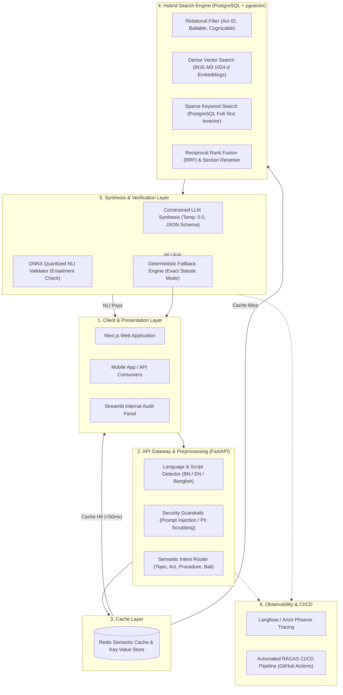
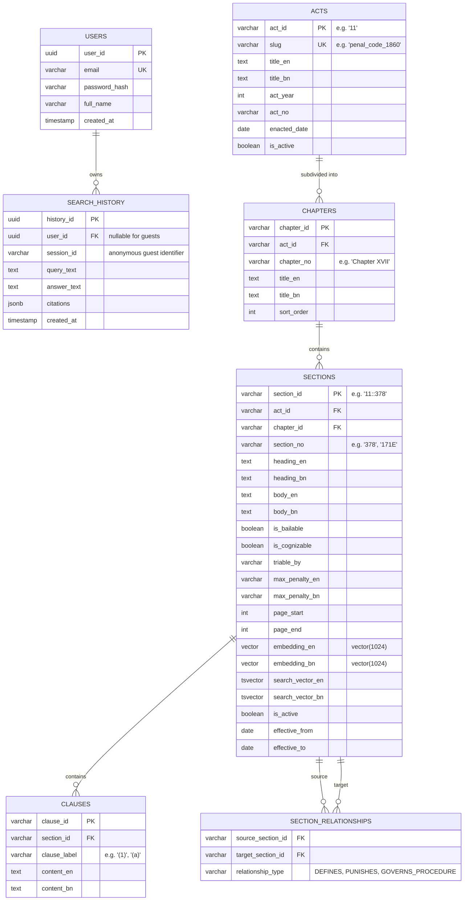
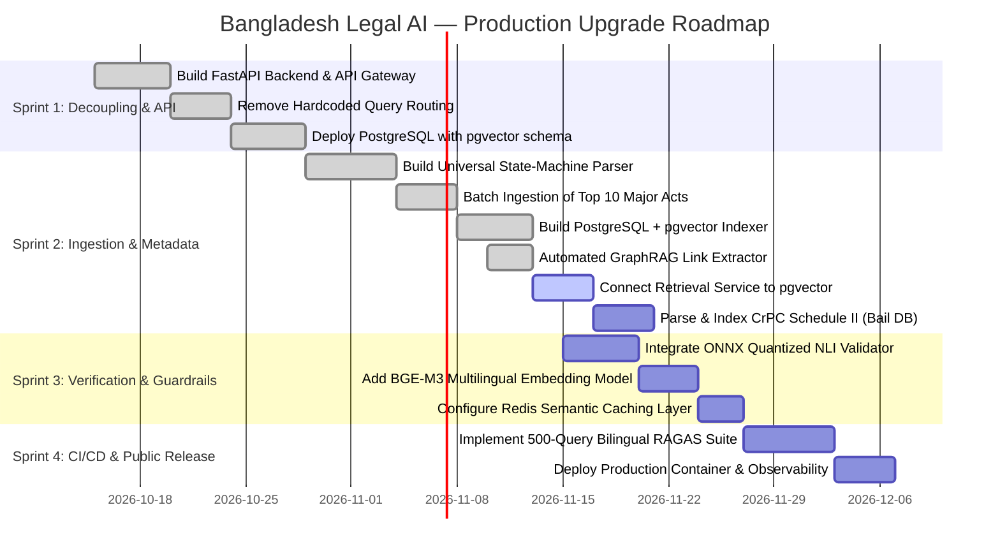

# Bangladesh Legal AI — Production Architecture, System Design & Upgrade Roadmap

> **Document Status:** Active Master Specification & Upgrade Tracker  
> **Target Audience:** Engineering Team, AI Architects, Legal Domain Experts, DevOps  
> **Scope:** Full-Scale Production Legal Intelligence Platform for Bangladesh Law (Bilingual: Bangla & English, Zero-Hallucination, API-First)

---

## Table of Contents
1. [Executive Summary & System Vision](#1-executive-summary--system-vision)
2. [Current Prototype vs. Target Production System (Gap Analysis)](#2-current-prototype-vs-target-production-system-gap-analysis)
3. [End-to-End System Architecture](#3-end-to-end-system-architecture)
4. [Database Architecture & Data Models (Polyglot Persistence)](#4-database-architecture--data-models-polyglot-persistence)
5. [Comprehensive Metadata Taxonomy](#5-comprehensive-metadata-taxonomy)
6. [Defense-in-Depth Zero-Hallucination Framework](#6-defense-in-depth-zero-hallucination-framework)
7. [Bilingual & Cross-Lingual Pipeline (Bangla + English + Banglish)](#7-bilingual--cross-lingual-pipeline-bangla--english--banglish)
8. [Architectural Trade-offs, Drawbacks & Engineering Fixes](#8-architectural-trade-offs-drawbacks--engineering-fixes)
9. [Pragmatic Knowledge Graph Design (Lightweight GraphRAG)](#9-pragmatic-knowledge-graph-design-lightweight-graphrag)
10. [Authentication Architecture & Backend Framework (FastAPI & Optional Auth)](#10-authentication-architecture--backend-framework-fastapi--optional-auth)
11. [System Upgrade Backlog & Execution Roadmap (Immediate Updates)](#11-system-upgrade-backlog--execution-roadmap-immediate-updates)

---

## 1. Executive Summary & System Vision

The **Bangladesh Legal AI Assistant** is designed as a mission-critical, enterprise-grade statutory legal research and reasoning engine. Unlike consumer conversational chatbots, this system operates under a **Precision-First, Zero-Tolerance Hallucination** mandate:

* **Statutory Grounding:** Every factual or procedural legal statement is bound to official Bangladesh Gazette enactments (e.g., Penal Code 1860, CrPC 1898, Contract Act 1872).
* **Bilingual Native:** Full parity across Bengali and English queries and citations.
* **Deterministic Verification:** Automatic post-generation mathematical entailment checks (NLI) to prevent confabulations.
* **Scalable Ingestion:** Automated scraping and hierarchical tree-parsing for 200+ major national enactments without manual hardcoding.

---

## 2. Current Prototype vs. Target Production System (Gap Analysis)

| Architectural Dimension | Current Prototype | Target Production System |
| :--- | :--- | :--- |
| **User Interface / Entrypoint** | Streamlit UI monolithic app ([app/streamlit_app.py](file:///F:/Self%20Project/Bangladesh%20Legal%20AI/app/streamlit_app.py)) | Headless **FastAPI** Gateway + Next.js Web UI + Mobile SDK |
| **Statute Coverage** | 2 laws (Penal Code §378/379 & Contract Act §2) | 200+ core Bangladesh Acts (~25,000+ statutory sections) |
| **Query Routing** | Hardcoded regex / string matching (`if "theft" in q:`) | Lightweight **LLM / Semantic Intent Router** + Pydantic schema |
| **Database & Vector Storage** | Local Chroma vector store downloaded via zip | **PostgreSQL + pgvector** (hybrid relational + vector store) |
| **Caching Layer** | None (Every request recomputes embeddings) | **Redis Semantic Cache** (Sub-50ms latency for top queries) |
| **Text Generation** | Hardcoded template strings (`simple_explanation`) | **Constrained LLM** (Gemini 1.5/2.0 Flash) with Temperature 0.0 |
| **Hallucination Control** | Strict manual section filtering only | **4-Layer Defense:** Context-lock, Pydantic quotes, ONNX NLI, Fallback |
| **Evaluation Suite** | 50 handcrafted test cases ([run_eval.py](file:///F:/Self%20Project/Bangladesh%20Legal%20AI/run_eval.py)) | 500+ bilingual test suite with **RAGAS** & CI/CD regression gates |

---

## 3. End-to-End System Architecture



---

## 4. Database Architecture & Data Models (Polyglot Persistence)

### 4.1 Storage Selection: PostgreSQL with `pgvector`
Instead of splitting data across an external vector store (e.g. Chroma) and a separate SQL database, production standardizes on **PostgreSQL with `pgvector`**:
* **Single Source of Truth:** Relational metadata (Act, Chapter, Section, Bail status) and vector embeddings reside in the same row.
* **ACID Transactions:** Legal amendments update both statutory text and embeddings atomically.
* **Composite Filtering:** Combined metadata constraints and vector similarity in a single native SQL query.

### 4.2 Relational Entity-Relationship (ER) Schema



---

## 5. Comprehensive Metadata Taxonomy

Every statutory chunk stored in the database is tagged with five categories of metadata to power deterministic filtering:

1. **Structural Metadata:**
   * `act_id`: Unique identifier (e.g. `"11"`).
   * `act_name_en` / `act_name_bn`: Official gazetted title.
   * `chapter_no` / `chapter_title`: Chapter grouping (e.g. `"Chapter XVII - Of Offences Against Property"`).
   * `section_no` / `section_heading`: Alphanumeric section numbering (handles sections like `"304A"`, `"171E"`).
   * `page_start` / `page_end`: Physical gazette/PDF page numbers for direct citation verification.
2. **Procedural & Criminal Law Metadata (from CrPC Schedule II):**
   * `is_bailable` (Boolean): Identifies whether police/court must grant bail as a matter of right.
   * `is_cognizable` (Boolean): Identifies whether police can arrest without warrant.
   * `is_compoundable` (Boolean): Identifies whether parties can legally settle out of court.
   * `triable_by` (String): Competent court jurisdiction (e.g., `"Court of Session"`, `"Magistrate of the 1st Class"`).
3. **Punishment Metadata:**
   * `max_imprisonment_days`: Normalized integer for mathematical sorting/filtering.
   * `punishment_summary_en` / `punishment_summary_bn`: Concise description of penalty.
4. **Linguistic & Transliteration Metadata:**
   * `has_official_bangla_version`: Flag indicating if gazette provides authenticated Bengali text.
   * `search_keywords_bn` / `search_keywords_en`: Injected colloquial synonyms (e.g. `"ঘুষ"` for bribery/§171E).
5. **Data Provenance & Audit Integrity:**
   * `source_url`: Permanent link on `bdlaws.minlaw.gov.bd`.
   * `source_sha256`: Hash of source PDF/HTML ensuring text has not been tampered with.
   * `effective_from` / `effective_to`: Temporal versioning dates for statutory amendments.

---

## 6. Defense-in-Depth Zero-Hallucination Framework

To guarantee absolute legal truthfulness, the system enforces a 4-tier pipeline:

```
[ User Query ]
      │
      ▼
[ Step 1: Retrieval & Context Boundary ]
  • Top 3-5 statutory sections fetched via pgvector + Full-text search
  • Injected into strict XML tag: <verified_legal_context>...</verified_legal_context>
      │
      ▼
[ Step 2: Constrained Synthesis (Temp: 0.0) ]
  • LLM parameters: temperature=0.0, top_p=1.0
  • Prompt instruction: "Answer ONLY using facts directly asserted in <verified_legal_context>.
    If not explicitly stated, return 'INSUFFICIENT_STATUTORY_CONTEXT'. Never extrapolate."
  • Output enforced via Pydantic schema requiring exact quote extraction
      │
      ▼
[ Step 3: Fast Fuzzy Quote Verification ]
  • Sub-millisecond RapidFuzz scan checks if extracted 'supporting_quote' exists in original section
      │
      ▼
[ Step 4: ONNX-Quantized NLI Entailment Validation ]
  • Cross-encoder NLI model (DeBERTa-v3 quantized) evaluates:
      Premise: [Retrieved Section Text]
      Hypothesis: [LLM Generated Sentence]
  • Score Classification:
      - Entailment Score ≥ 0.85 ──> PASS: Return answer with full citation
      - Entailment Score 0.60–0.84 ──> WARNING: Show answer + explicit verification notice
      - Entailment Score < 0.60 ──> FAIL: Trigger Fallback Mode
      │
      ▼
[ Step 5: Deterministic Fallback Mode ]
  • Drops generated prose entirely.
  • Displays clean, official gazette text of the top section with verified disclaimers.
```

---

## 7. Bilingual & Cross-Lingual Pipeline (Bangla + English + Banglish)

1. **Script & Language Identification:**
   * Fast script analysis detects whether input is in Bengali script (Unicode `0980–09FF`), English, or Banglish (Latin script phonetically representing Bengali).
2. **Banglish Normalization:**
   * Phonetic Banglish queries (e.g., *"churi korle ki shasti?"*) are mapped to standardized Bengali (*"চুরি করলে কি শাস্তি?"*) via a deterministic phonetic dictionary and lightweight transliteration model before querying the search layer.
3. **Cross-Lingual Embedding Retrieval (BGE-M3):**
   * BGE-M3 maps Bengali queries and English legal enactments into the same unified vector space. A query submitted in Bengali matches relevant English statutory provisions seamlessly and vice-versa.
4. **Targeted Output Rendering:**
   * If query is in Bengali $\rightarrow$ Answer synthesized in natural Bengali, citing Bengali section titles where available.
   * If query is in English $\rightarrow$ Answer synthesized in formal English, citing official English act names.

---

## 8. Architectural Trade-offs, Drawbacks & Engineering Fixes

| Identified Bottleneck / Drawback | Root Cause | Engineering Solution in Production |
| :--- | :--- | :--- |
| **NLI Latency Tax (~1.0s delay)** | Cross-encoder sequence classification on CPU is slow | Convert DeBERTa to **ONNX Runtime with Int8 quantization** (<40ms latency) + RapidFuzz quote pre-check |
| **Bengali Legal Terminology Gap** | Generic multilingual models lack nuance on archaic Sanskrit/Persian legal roots | **Domain-Adaptive Fine-Tuning (DAPT)** on 3,000+ curated Bangladesh legal QA pairs using MNRL loss |
| **Database Sync / Amendment Overhead** | Re-embedding 25,000 sections on amendment can desync cache | **PostgreSQL Triggers + Event-Driven Celery workers**; tag-based Redis cache invalidation per `act_id` |
| **Multi-Law Context Dilution** | Stufing 15 sections across 4 laws into one prompt causes attention failure | **Query Decomposition + Map-Reduce Synthesis**: Summarize legal points per act first, then combine |

---

## 9. Pragmatic Knowledge Graph Design (Lightweight GraphRAG)

Rather than introducing an expensive Neo4j database on Day 1, production implements **GraphRAG natively inside PostgreSQL** using a relational `section_relationships` junction table:

```
[ Section 378 (Theft Definition) ]
        │
        ├── [REQUIRES_CONCEPT] ────> [ Section 22 (Moveable Property Defined) ]
        ├── [PUNISHED_BY] ─────────> [ Section 379 (Punishment for Theft) ]
        ├── [AGGRAVATED_FORM] ─────> [ Section 380 (Theft in Dwelling House) ]
        └── [PROCEDURE_LINK] ──────> [ CrPC Schedule II (Entry for §379: Non-bailable) ]
```

### Relational Graph Traversal via SQL CTE:
```sql
WITH RECURSIVE LegalGraph AS (
    -- Anchor: Directly retrieved top section
    SELECT source_section_id, target_section_id, relationship_type, 1 AS depth
    FROM section_relationships
    WHERE source_section_id = '11::378'

    UNION ALL

    -- Recursive Step: 1-hop related legal sections
    SELECT r.source_section_id, r.target_section_id, r.relationship_type, lg.depth + 1
    FROM section_relationships r
    JOIN LegalGraph lg ON r.source_section_id = lg.target_section_id
    WHERE lg.depth < 2
)
SELECT * FROM LegalGraph;
```
---

## 10. Authentication Architecture & Backend Framework (FastAPI & Optional Auth)

### 10.1 The "Optional Authentication" Pattern (Guest vs. Authenticated User)
A public legal utility requires zero-friction onboarding. Citizens facing urgent legal emergencies must not be blocked by mandatory login walls:

* **Guest User (Unauthenticated):**
  * **Access:** Full query access to all indexed statutory databases without signup.
  * **Search History:** Persisted client-side only (Browser `localStorage`). Cleared automatically upon browser closure or cookie reset.
  * **Rate Limiting:** IP-based sliding window rate limiter (e.g., 20 queries/day per IP via Redis) to prevent scraping.
* **Authenticated User (Logged-in):**
  * **Login Methods:** Google One-Tap OAuth2 and Phone OTP (Twilio / SMS Gateway).
  * **Search History:** Server-side persistence in PostgreSQL `search_history` table linked to `user_id`.
  * **Value Proposition:** Cross-device synchronization (queries performed on mobile sync to desktop), case research bookmarks, and PDF export capabilities.

### 10.2 Why FastAPI for Legal AI Workloads?
FastAPI is the architectural standard for AI-driven applications due to four distinct engineering advantages over Django and Flask:

1. **Native Asynchronous Concurrency (`async` / `await` & `uvloop`):**
   * Legal RAG pipelines spend ~90% of processing time awaiting I/O (vector search queries, database reads, and LLM inference).
   * Synchronous frameworks (like standard Flask/Django) block execution worker threads during LLM wait times, collapsing under concurrent traffic.
   * FastAPI's non-blocking event loop processes concurrent user requests concurrently on a single worker thread, dramatically reducing VPS infrastructure costs.
2. **First-Class Pydantic Integration:**
   * Strict serialization and automated validation for complex legal schemas (Citations, Statutes, Clauses).
   * Auto-generates production OpenAPI / Swagger specifications (`/docs`) for external client integration.
3. **In-Memory Python AI Stack Integration:**
   * Eliminates inter-process communication (IPC) overhead. Tokenizers, BGE-M3 models, ONNX runtime engines, and RapidFuzz execute directly in the same memory space as the web worker.
4. **Clean Dependency Injection for Optional Auth:**
   * FastAPI's `Depends` system allows elegant optional user extraction without conditional spaghetti code.

### 10.3 Implementation: Optional Authentication Dependency
```python
from fastapi import APIRouter, Depends, Header
from typing import Optional
from pydantic import BaseModel

router = APIRouter()

async def get_optional_current_user(
    authorization: Optional[str] = Header(None)
) -> Optional[User]:
    """Extracts user if valid JWT Bearer token is provided; returns None for guests."""
    if not authorization or not authorization.startswith("Bearer "):
        return None
    token = authorization.split(" ")[1]
    return await verify_jwt_and_fetch_user(token)

@router.post("/v1/query", response_model=QueryResponse)
async def query_legal_assistant(
    request: QueryRequest,
    user: Optional[User] = Depends(get_optional_current_user)
):
    # 1. Execute end-to-end RAG pipeline
    result = await legal_rag_service.process_query(request.query)
    
    # 2. Persist history conditionally
    if user:
        await save_history_to_db(user_id=user.id, query=request.query, result=result)
    
    return result
```

---

## 11. System Upgrade Backlog & Execution Roadmap (Immediate Updates)

This roadmap outlines the prioritized engineering sprints to transition the project from the prototype to full production:



### 📋 Detailed Task Backlog for Immediate Execution

#### Priority 1: Architectural Decoupling & API First (Immediate Sprint)
- [x] **Task 1.1:** Create `app/api/` package and deploy a **FastAPI** server exposing:
  - `POST /v1/query`: Core synchronous QA endpoint returning answer, structured citations, and evidence array.
  - `POST /v1/search`: Direct statutory retrieval endpoint returning raw sections with similarity scores.
  - `GET /health`: Healthcheck endpoint validating database and embedding model readiness.
  - `GET /v1/statutes`: Statutory catalog and metadata discovery endpoint.
- [x] **Task 1.2:** Eliminate hardcoded string checks in [app/rag_backend.py](file:///F:/Self%20Project/Bangladesh%20Legal%20AI/app/rag_backend.py). Replace `analyze_query()` heuristics with an extensible Pydantic-based intent classifier.
- [x] **Task 1.3:** Setup local Docker Compose orchestrating `api` (FastAPI) and `ui` (Streamlit) services via `docker-compose.yml`.
- [x] **Task 1.4:** Design Master **PostgreSQL + pgvector** schema in `db/schema.sql` with HNSW vector index (`vector(1024)`), GIN full-text `tsvector` indexes, relational metadata, and GraphRAG `section_relationships` junction table.

#### Priority 2: Data Scaling & Universal Ingestion Engine
- [x] **Task 2.1:** Convert ingestion logic into a reusable CLI script: `ingestion/universal_parser.py` (hierarchical Act -> Chapter -> Section -> Clause state machine).
- [x] **Task 2.2:** Construct `ingestion/laws_manifest.json` cataloging initial 10 foundational acts and write automated HTML scraper (`ingestion/scraper.py`).
- [x] **Task 2.3:** Ingest & parse top 10 foundational Bangladesh Acts (1,079 sections total across Penal Code, Contract Act, Evidence Act, CrPC, CPC, Cyber Security Act, etc.) into structured JSON in `data/parsed_acts/`.
- [x] **Task 2.4:** Build `ingestion/indexer.py` to batch insert parsed statutes into PostgreSQL with multilingual embeddings, tsvector sparse index, and GraphRAG links.
- [x] **Task 2.5:** Replace hardcoded knowledge graph seed list with automated statutory syntax extractor in `ingestion/graph_extractor.py` (228 automated legal relationships discovered and indexed).
- [x] **Task 2.6:** Create interactive database diagnostic and audit CLI in `scripts/inspect_db.py`.
- [ ] **Task 2.7:** Connect `app/services/retrieval_service.py` directly to PostgreSQL + pgvector (Dense HNSW Vector + Sparse tsvector + RRF Rank Fusion + 1-hop GraphRAG Traversal).
- [ ] **Task 2.8:** Parse CrPC 1898 Schedule II into `crpc_schedule_lookup.json` to automate tagging of `is_bailable` and `is_cognizable` across criminal offences.

#### Priority 3: Verification Guardrails & Zero-Hallucination
- [ ] **Task 3.1:** Deploy ONNX-quantized `DeBERTa-v3` cross-encoder for post-generation entailment scoring.
- [ ] **Task 3.2:** Configure Pydantic Structured Output schema demanding `cited_section` and `verifiable_quote` fields from the synthesis LLM.
- [ ] **Task 3.3:** Implement graceful deterministic fallback: if entailment fails or confidence drops below 0.60, return official statutory text directly.

#### Priority 4: Evaluation, CI/CD & Observability
- [ ] **Task 4.1:** Expand [docs/eval_queries.json](file:///F:/Self%20Project/Bangladesh%20Legal%20AI/docs/eval_queries.json) from 50 cases to 200+ bilingual test scenarios covering edge cases, negative out-of-scope refusals, and bail inquiries.
- [ ] **Task 4.2:** Integrate **Langfuse** middleware to track latency, token utilization, and retrieval scores across all queries in production.
- [ ] **Task 4.3:** Add GitHub Actions CI workflow executing automated regression benchmarks on every pull request.

---

> **Maintained By:** Lead AI Architect & Systems Engineering Team  
> **Last Updated:** October 2026 | Production Upgrade Release Track

